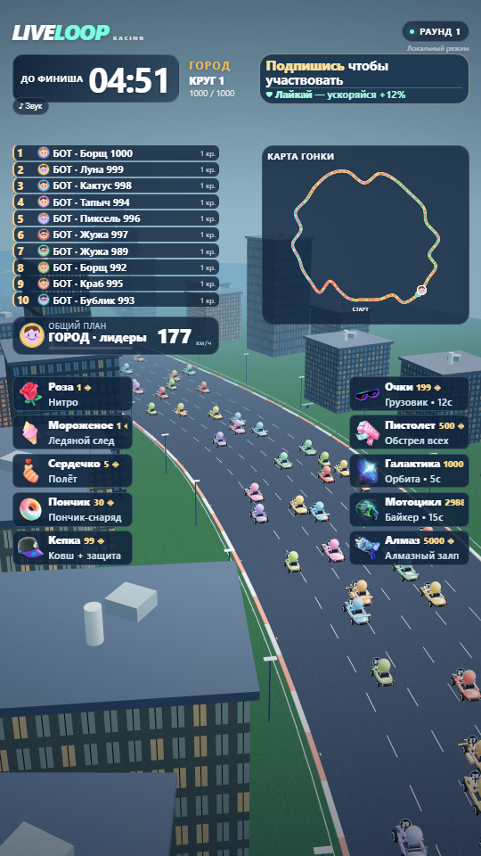
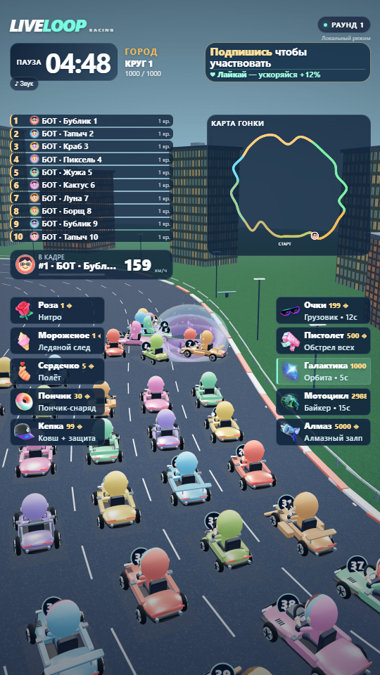
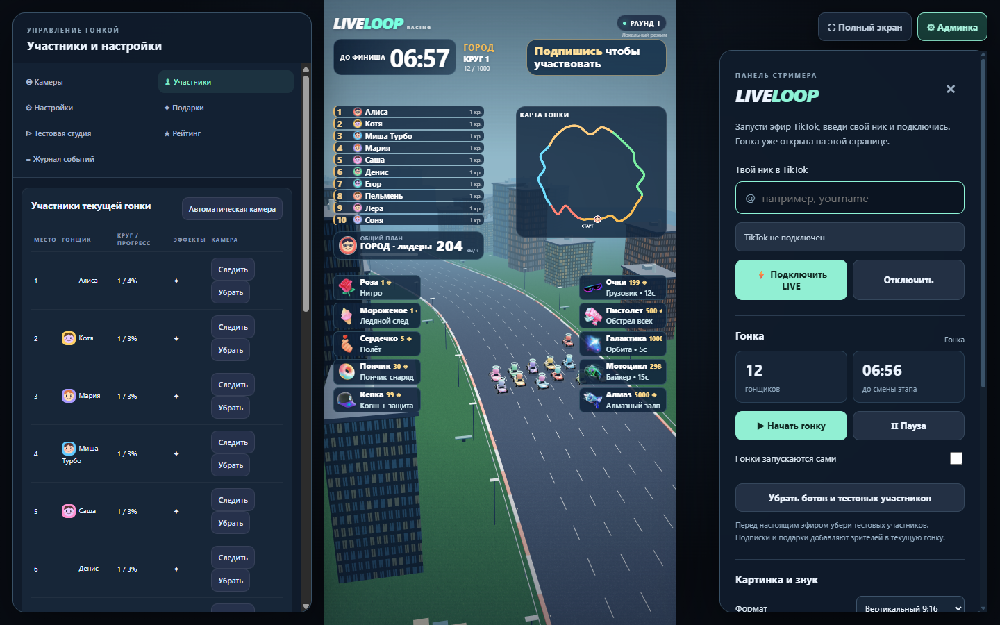

# Live Loop Racers

**Automatic 3D races powered by TikTok LIVE audience events.**

Viewers join the race, boost their cars with likes, and trigger game effects with gifts. The app runs locally and provides an OBS browser overlay, streamer controls, and an offline simulator.

[Русская инструкция](README_RU.md) · [Architecture](docs/ARCHITECTURE.md) · [Development](CONTRIBUTING.md) · [Third-party notices](THIRD_PARTY_LICENSES.md)

<p align="center">
  
  
</p>

## Features

- A procedural 4.24 km track with city, forest, desert, ocean and volcano zones.
- Up to 1,000 race participants, with batched rendering and visibility culling.
- Ten gift effects, including nitro, ice trails, balloons, projectiles, a truck, a motorcycle and an orbital effect.
- Automatic broadcast cameras, fixed track views and individual racer tracking.
- Vertical and horizontal layouts, audio controls and an OBS overlay.
- Streamer controls for participants, gifts, track events, results and persistent ratings.
- An offline simulator for testing follows, likes, gifts, duplicates and disconnects.
- Local TikTok event transport with reconnect handling and gift-series deduplication.

## Quick start

Requires **Node.js 22.12+** and npm. Windows is the supported desktop packaging target. A browser with WebGL is required for rendering.

```sh
npm ci
npm run server
```

Open **http://127.0.0.1:3210**. The race appears in the centre; open **Админка** for LIVE controls. Detailed controls and keyboard shortcuts are in the [Russian guide](README_RU.md).

On Windows, `setup.bat` installs dependencies and generates fallback assets. Then `run.bat` opens the browser app. `npm start` launches the separate Electron game and panel windows.

### Try it without TikTok

1. Open the local app and select **Тестовая студия** in the management panel (or open `/panel`).
2. Add simulated participants, then start the race.
3. Trigger likes and gifts from the test controls.
4. Before a real broadcast, use **Убрать ботов и тестовых участников** to remove simulated users.

### Connect a LIVE room

Start a TikTok LIVE broadcast, enter the account handle in the admin panel, and select **Подключить LIVE**. A paid API key is not required by the included connector. Connectivity depends on TikTok availability, region, an active broadcast and changes to its unofficial protocol.

### OBS

Use `http://127.0.0.1:3210/?overlay=1` as a Browser Source. Set **1080 × 1920** for portrait or **1920 × 1080** for landscape and select the matching orientation in the app. `/game` serves the standalone game; `/panel` serves the full control panel.

## Streamer interface



## Commands

| Command | Purpose |
| --- | --- |
| `npm run server` | Start the local browser app |
| `npm start` | Open the Electron desktop windows |
| `npm test` | Run the automated engine, protocol and server tests |
| `npm run soak -- 600` | Simulate 600 seconds of game time |
| `npm run verify:visual` | Render QA scenes, test gift effects and capture screenshots |
| `npm run build` | Create a portable Windows app; the target folder must not already exist |

Visual checks write to `verification/`, which is excluded from Git. They use isolated test data. Screenshots in this README show simulated participants, not a live customer broadcast.

## Storage and configuration

The Windows browser launcher stores data in `%APPDATA%/live-loop-racers/data`. Direct `npm run server` uses `./data` by default; the Electron app uses its user-data directory. Saves contain settings, participant profiles and ratings, with a backup file.

For direct server launch, `PORT` overrides the default port `3210` and `LIVE_RACERS_DATA` selects the data directory. The server binds to `127.0.0.1`. It is designed as a local streamer tool, not a public hosted service.

## Implementation

JavaScript ES modules · Node.js · Three.js · WebSocket · Electron · sharp · vendored `ttl-live` transport.

The server owns the simulation. Clients receive compact state snapshots and interpolate motion for presentation. Repeated vehicle geometry is batched; the renderer draws visible vehicles rather than every participant at once. See [the architecture notes](docs/ARCHITECTURE.md) for the module map and event flow.

## Limitations

- TikTok integration uses an unofficial protocol and can break independently of the game.
- The protocol does not guarantee a departure event or a complete list of present viewers. Manual removal is available.
- The 1,000-participant limit is a simulation capacity, not a guarantee of 1,000 simultaneously visible cars or a particular frame rate. Performance depends on the GPU, scene, resolution and broadcast workload.
- Automated and visual tests do not replace a real LIVE and OBS session on the target machine.
- Portable packaging is Windows-specific. Browser use on other systems is not yet a supported release target.

## License and attribution

Project code is licensed under [MIT](LICENSE). This does **not** apply to all third-party material. TikTok gift images have separate rights; the transport includes protocol schemas with their own license and additional terms. Music sources, dependency notices and the vendored upstream revision are documented in [THIRD_PARTY_LICENSES.md](THIRD_PARTY_LICENSES.md) and [UPSTREAM.json](server/vendor/ttl-live/UPSTREAM.json).

This is an independent project and is not affiliated with or endorsed by TikTok.
